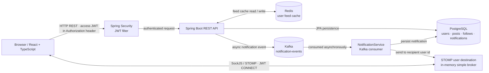
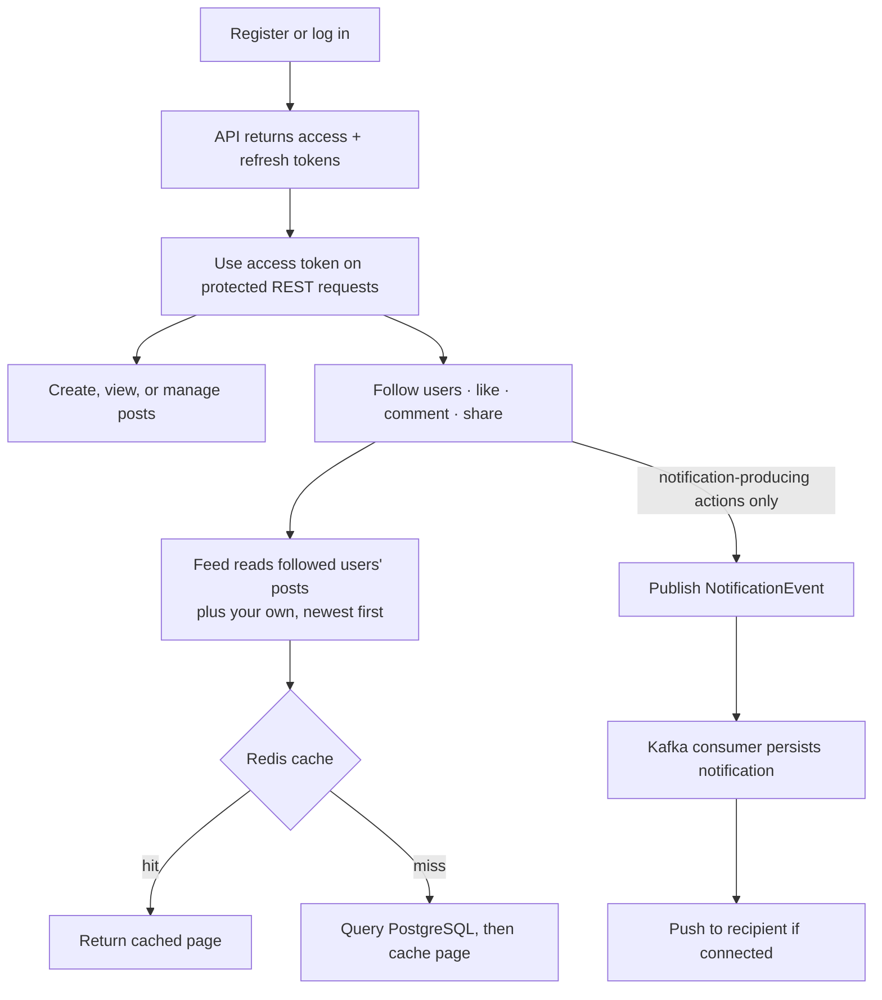
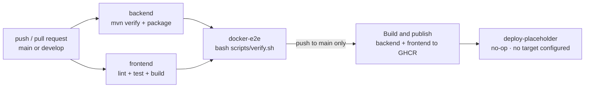

<p align="center">
  
</p>

<p align="center">
  <a href="https://github.com/channallikrishnasai/SocialMediaPlatform/actions/workflows/ci-cd.yml">
    
  </a>
  
  
  
  
  <a href="LICENSE"></a>
</p>

<p align="center">
  <strong>Real-time social experiences, built as a full-stack engineering project.</strong><br>
  Spring Boot · React · PostgreSQL · Redis · Kafka · WebSockets
</p>

> The hero is original SVG concept artwork—not a screenshot of the running application. No hosted demo or product recording is published.

## Navigate

[Introduction](#project-introduction) · [Features](#feature-matrix) · [Stack](#tech-stack) · [Architecture](#architecture) · [User flow](#core-user-flow) · [Notifications](#notification-sequence) · [Responsibilities](#system-responsibilities) · [Automation](#automation-and-cicd) · [Testing](#testing-dashboard) · [Setup](#getting-started) · [API & security](#api-and-security) · [Roadmap](#limitations-and-roadmap) · [Contributing](#contributing-and-attribution)

## Project introduction

A full-stack social platform for publishing posts, building a follow graph, browsing a chronological feed, and receiving asynchronous notifications. The Java API and React client run with PostgreSQL, Redis, Kafka, and a STOMP/SockJS notification channel.

**Implemented:** email/password registration and login, JWT access/refresh flow, post CRUD, likes, comments, shares, follow lists, a following-based feed, feed caching, persisted notifications, and live delivery to connected users.

**Incomplete or environment-dependent:** Google OAuth2 has backend support but no frontend sign-in/callback flow and needs real provider credentials for runtime verification; the Settings screen and navbar search are placeholders; images are URL references, not uploaded files; and no cloud deployment target is configured.

## Feature matrix

| Feature | Description | Implementation |
|---|---|---|
| Authentication | Registration and login | **Implemented** — email/password, BCrypt, signed access and refresh JWTs; Google OAuth is partial (backend configured; no frontend launch/callback flow) |
| Posts | Create, edit and delete | **Implemented** — ownership checks; optional `imageUrl` and shared-post reference |
| Engagement | Likes, comments and shares | **Implemented** — likes/comments and share posts; relevant interactions publish notifications |
| Social graph | Follow and unfollow | **Implemented** — follower/following lists; duplicate follows are idempotent |
| Feed | Chronological following-based feed | **Implemented** — newest first, posts from followed users plus the viewer's own posts |
| Caching | Redis-backed feed caching | **Implemented** — 10-minute TTL, hit/miss metrics, broad cache eviction on post/follow changes |
| Notifications | Kafka and WebSocket flow | **Implemented** — async event, database persistence, then STOMP push when the recipient is connected |
| Observability | Actuator and metrics | **Implemented** — health, metrics, Prometheus, and custom counters |
| Search and settings | Search users/posts and account settings | **Planned** — search input is presentational; Settings currently displays “coming soon” |

## Tech stack

| Area | Technologies |
|---|---|
| Frontend | React 18, TypeScript, Vite, Material UI, Redux Toolkit, TanStack Query, Axios |
| Backend | Java 17, Spring Boot 3.2, Spring MVC, Spring Data JPA, Spring Security, Flyway |
| Data storage | PostgreSQL 15 for durable application data; Redis 7 for the feed cache |
| Messaging | Apache Kafka with ZooKeeper in Compose; one `notification-events` topic (3 partitions, 1 replica) |
| Authentication | Spring Security, BCrypt, HS256 JWT access/refresh tokens, optional Google OAuth2 |
| Real-time transport | STOMP over WebSocket/SockJS, authenticated using a JWT in the STOMP `CONNECT` frame |
| Testing | JUnit 5, Spring tests, Testcontainers, Vitest, React Testing Library, Playwright |
| Infrastructure | Docker, Docker Compose, Nginx frontend container |
| Automation and observability | GitHub Actions, Dependabot, Spring Boot Actuator, Micrometer, Prometheus |

## Architecture

The browser reaches the Spring Security filter chain for REST requests and separately opens the authenticated STOMP connection. The feed path reads/writes Redis and falls back to PostgreSQL. Notification-producing actions publish to Kafka; a consumer persists each notification before attempting live delivery.



## Core user flow

Feed retrieval and notification production are related user journeys, not one synchronous transaction. Only follow, like, comment, and share actions produce notification events; creating or viewing a post does not.



## Notification sequence

The recipient's STOMP session is established independently of the action. The REST action does not wait for a WebSocket push: Kafka consumption and notification persistence happen asynchronously.

```mermaid
sequenceDiagram
    participant Actor as React client (actor)
    participant API as Spring Boot API
    participant DB as PostgreSQL
    participant K as Kafka
    participant C as NotificationService
    participant WS as STOMP broker
    participant Recipient as React client (recipient)

    Recipient->>WS: Connect to /ws with JWT in STOMP CONNECT
    Recipient->>WS: Subscribe to /user/queue/notifications
    Actor->>API: Like, comment, share, or follow with access JWT
    API->>DB: Persist domain change
    API-->>K: Publish NotificationEvent (asynchronous)
    API-->>Actor: Return REST response
    K-->>C: Deliver notification-events record
    C->>DB: Persist Notification
    C->>WS: convertAndSendToUser(recipientId, ...)
    opt Recipient still connected
        WS-->>Recipient: Push persisted notification
    end
```

## System responsibilities

| Component | Responsibility | Important behavior |
|---|---|---|
| React | Authenticated user interface | Axios attaches access JWTs and refreshes on 401; Redux stores auth/notification state; React Query fetches API data |
| Spring Boot | REST API and application services | Spring Security protects API routes; services enforce resource ownership and produce notification events |
| PostgreSQL | Durable application persistence | Stores users, posts, follows, likes, comments, and notifications; Flyway manages schema |
| Redis | Feed-page cache | Feed cache has a 10-minute TTL; mutations evict all entries in the `userFeed` cache |
| Kafka | Asynchronous notification event transport | `notification-events` has one event DTO and consumer; no dead-letter topic or notification deduplication is configured |
| WebSocket | Live notification delivery | STOMP/SockJS with JWT-validated CONNECT; Spring's simple broker routes to connected sessions and is not a clustered broker |
| GitHub Actions | Build, test, end-to-end check, and image publishing | CI/CD jobs are defined in `.github/workflows/ci-cd.yml`; the final deploy job is explicitly a no-op |

Actuator exposes `/actuator/health`, `/actuator/metrics`, and `/actuator/prometheus`. Custom meters cover `posts.created`, `follows.created`, `likes.created`, `feed.cache.hit`, `feed.cache.miss`, `kafka.events.produced`, `kafka.notifications.consumed`, and `websocket.notifications.sent`.

## Automation and CI/CD

The workflow below documents configured behavior, not a promise that every future run will pass.

| Automation | Trigger | What it does |
|---|---|---|
| Backend verification | Push or pull request to `main` / `develop` | Java 17; `mvn verify`, then packages the backend artifact |
| Frontend verification | Push or pull request to `main` / `develop` | Node 20; `npm ci`, lint, Vitest, production build, and artifact upload |
| Full-stack verification | After backend and frontend jobs succeed | Runs `bash scripts/verify.sh` against Docker Compose services |
| Container publishing | Push to `main`, after verification jobs succeed | Builds and pushes backend and frontend images to GHCR |
| Deployment placeholder | Push to `main`, after image publishing | Prints that no deployment target is configured; it does not deploy |
| Dependabot | Weekly schedule | Checks GitHub Actions, Maven, and npm dependencies and can open update PRs |

**Latest observed status:** the most recent `main` push before this documentation change completed successfully on `22bae00` ([workflow run](https://github.com/channallikrishnasai/SocialMediaPlatform/actions/runs/38007939452), 2026-10-10 UTC). That run predates this README/SVG commit; its status does not validate the new commit. The badge at the top is live.

Image publishing is automated; deployment remains manual and requires external service accounts, environment configuration, and provider setup. See [DEPLOYMENT_FREE.md](DEPLOYMENT_FREE.md); it is a guide, not a live deployment or infrastructure-as-code configuration.



## Testing dashboard

| Check | Command | Requirements |
|---|---|---|
| Backend unit and controller-slice tests | `cd backend && mvn test -Dtest='!*IntegrationTest'` | JDK 17 and Maven |
| Backend suite, including Testcontainers integration tests | `cd backend && mvn verify` | JDK 17, Maven, and a working Docker daemon |
| Frontend lint | `cd frontend && npm ci && npm run lint` | Node.js 20 and npm |
| Frontend tests | `cd frontend && npm test -- --run` | Node.js 20 and npm |
| Frontend production build | `cd frontend && npm run build` | Node.js 20 and npm |
| Browser E2E (Playwright) | Start the app, then `cd frontend && E2E_BASE_URL=http://localhost:3000 npm run test:e2e` | App reachable at the base URL and Playwright Chromium installed |
| Docker-based full-stack verification | `bash scripts/verify.sh` | Docker, Maven, Node/npm, curl, and jq |

`scripts/verify.sh` builds and tests the services, exercises registration, posts, follows, feed caching, Kafka notifications, WebSocket delivery, and metrics against a Compose stack, then tears it down with `docker compose down -v`. **That cleanup removes the Compose database volume.** Do not run it if you need to preserve data in that volume.

**Validation for this README update:** backend unit/controller suite — 47 passed; frontend lint — passed; Vitest — 5 passed; production build — passed with Vite's non-blocking warning that the minified JavaScript chunk exceeds 500 kB. `mvn verify` was attempted but its four Testcontainers integration tests could not initialize: this environment's Docker daemon requires API 1.40 while the available Docker client requests 1.32. The Docker-based full-stack script was not run because its cleanup removes the Compose database volume. The [verification report](docs/VERIFICATION_REPORT.md) separately records 51 backend tests passing in an earlier GitHub Actions run. No performance or load-test measurements are claimed.

The earlier verification report also documents `ConcurrencyIntegrationTest`: ten simultaneous duplicate follow requests and ten duplicate like requests resulted in one database row per operation on its Testcontainers-backed run.

## Getting started

### Prerequisites

- Docker Engine with the Compose plugin
- Java 17 and Maven for local backend development
- Node.js 20 and npm for local frontend development
- `curl` and `jq` for the full verification script

### Run the complete stack

From the repository root:

```bash
docker compose up --build
```

Compose starts PostgreSQL, Redis, ZooKeeper, Kafka, the API, and the frontend. Its embedded database credentials and JWT secret are local-development defaults—do not reuse them outside a disposable local environment. Compose does not automatically load `backend/.env.example` or `frontend/.env.example`.

For standalone backend development, the configurable variables are documented in [`backend/.env.example`](backend/.env.example); the Vite API URL is documented in [`frontend/.env.example`](frontend/.env.example). Database, Redis, Kafka, and JWT settings are needed for a local backend; Google OAuth values are optional and require a registered Google OAuth client.

| Service | Local address |
|---|---|
| Frontend | [http://localhost:3000](http://localhost:3000) |
| Backend API | [http://localhost:8080](http://localhost:8080) |
| Swagger UI | [http://localhost:8080/swagger-ui.html](http://localhost:8080/swagger-ui.html) |
| OpenAPI JSON | [http://localhost:8080/api-docs](http://localhost:8080/api-docs) |
| Health | [http://localhost:8080/actuator/health](http://localhost:8080/actuator/health) |
| Prometheus metrics | [http://localhost:8080/actuator/prometheus](http://localhost:8080/actuator/prometheus) |

Stop the stack while retaining its named database volume with `docker compose down`. Use `docker compose down -v` only when you intend to delete local database data.

### Local development

Start the infrastructure containers:

```bash
docker compose up -d postgres redis zookeeper kafka
```

In a terminal at the repository root, load the backend's example values for local use, then start Spring Boot:

```bash
cp backend/.env.example backend/.env
set -a
. ./backend/.env
set +a
cd backend
mvn spring-boot:run
```

Review the copied file before sourcing it and replace placeholder values for any external integration. In a second terminal:

```bash
cd frontend
npm ci
npm run dev
```

Vite serves the development client at [http://localhost:5173](http://localhost:5173). The default API base URL is `http://localhost:8080/api`.

### Troubleshooting

- **Port already in use:** stop the conflicting service or adjust the published ports in `docker-compose.yml`.
- **Backend starts before dependencies are ready:** check `docker compose ps` and wait for PostgreSQL, Redis, Kafka, and the backend health check.
- **Cannot connect to PostgreSQL or Redis locally:** confirm the local services are running and that the backend uses `localhost` settings, not Compose-only service names.
- **Managed Redis connection fails:** TLS must match the provider; set `REDIS_SSL_ENABLED=true` for TLS-only Redis and leave it `false` for the local Compose Redis.
- **Container frontend points at the wrong API:** `VITE_API_BASE_URL` is baked into the Vite bundle at image-build time. Rebuild the frontend image after changing its build argument.
- **Google sign-in does not complete:** sample OAuth values are placeholders; configure a real client ID, secret, and matching redirect URI.

For the expanded local checklist, see [SETUP_GUIDE.md](SETUP_GUIDE.md).

## API and security

### Authentication model

`POST /api/auth/register` and `POST /api/auth/login` return an access token, refresh token, and user payload. Access tokens are configured for 24 hours and refresh tokens for 7 days. Protected REST calls include the access JWT in the `Authorization` header. `POST /api/auth/refresh` accepts the refresh token in the `Refresh-Token` header. The frontend stores both tokens in `localStorage` and its Axios interceptor retries a request once after a 401.

Passwords are BCrypt-hashed. Access and refresh tokens are HMAC/HS256-signed JWTs. Spring Security is stateless for REST API requests; user-specific services enforce ownership for protected operations. A user role is stored, but no role-based endpoint policy is currently configured. Google OAuth2 is incomplete: the backend success handler issues JWTs in URL query parameters, but React has no sign-in entry or callback handler to capture them. Do not treat this as a usable client flow; it also lacks live verification with real Google credentials.

For WebSockets, the `/ws` HTTP handshake is permitted, while the STOMP `CONNECT` frame must carry a valid JWT in its `Authorization` header. The backend binds the authenticated user ID to the session and sends notifications to `/user/queue/notifications`.

### API reference

OpenAPI is configured at `/api-docs` and Swagger UI at `/swagger-ui.html` (both available locally at the addresses above). Public access is allowed by the current security configuration; restrict these endpoints in a public production deployment.

| Method and path | Purpose |
|---|---|
| `POST /api/auth/register`, `POST /api/auth/login` | Create an account or authenticate |
| `POST /api/auth/refresh` | Exchange the `Refresh-Token` header for a new token response |
| `GET /api/feed?page=0&size=20` | Read the paginated chronological feed |
| `POST /api/posts`, `PUT /api/posts/{postId}`, `DELETE /api/posts/{postId}` | Create and manage owned posts |
| `POST /api/posts/{postId}/like`, `DELETE /api/posts/{postId}/like` | Like or unlike a post |
| `POST /api/posts/{postId}/comments` | Comment on a post |
| `POST /api/users/{userId}/follow`, `DELETE /api/users/{userId}/follow` | Follow or unfollow a user |
| `GET /api/notifications?page=0&size=20` | List persisted notifications for the authenticated user |

The auth endpoints are rate-limited to 5 requests per minute, post creation to 30 per minute, and feed reads to 100 per minute. Request DTOs use Jakarta validation; JPA repositories use parameterized queries; ownership violations return 403; unexpected server errors are logged and returned without raw exception details.

### Security considerations

- The application disables CSRF and configures CORS with `allowedOriginPatterns("*")` and credentials. Restrict browser origins and review CSRF protections before production use.
- JWTs are stored in browser `localStorage`; an XSS flaw could expose them. Production deployments should assess a safer token-storage strategy.
- The repository's Compose values and `.env.example` values are development placeholders, not production secrets.
- The app does not enforce HTTPS. Terminate TLS at a trusted proxy/platform and use secure transport for all external services.
- Actuator health/metrics endpoints and Swagger are permitted by the current API security rules; apply deployment-level access controls as needed.

See [docs/SECURITY.md](docs/SECURITY.md) for configuration guidance and the [verification report](docs/VERIFICATION_REPORT.md) for tested behavior and known gaps.

## Limitations and roadmap

| Status | Area | Current state / next step |
|---|---|---|
| **Partial** | Google OAuth2 | Spring client and backend success handler exist, but the frontend has no sign-in entry or token-capture route; tokens are redirected in URL query parameters and must not be treated as production-safe. End-to-end login also needs real Google credentials |
| **Not implemented** | Image uploads | Posts accept an `imageUrl`; there is no upload endpoint or object-storage integration |
| **Not implemented** | Search | Navbar search is a placeholder and has no search API/workflow |
| **Not implemented** | Settings | The Settings route renders a “coming soon” placeholder |
| **Current scope** | Feed ranking | Feed is chronological, not ranked or ML-personalized |
| **Known trade-off** | Feed cache invalidation | Mutations evict every `userFeed` entry rather than only affected users' pages |
| **Known gap** | Kafka delivery guarantees | The notification consumer has no deduplication key or dead-letter topic; repeated event delivery can create duplicate notifications |
| **Not implemented** | Production deployment | No cloud deployment target, IaC, or live application URL is configured. The GitHub Actions deploy job is a no-op after image publishing |
| **Environment-dependent** | OAuth and managed services | Provider login and external PostgreSQL/Redis/Kafka deployment need real accounts, secrets, and operational verification |

No application recording is included. Contributors can run the local stack and capture a genuine demo later; the Playwright happy-path test is documented above but is not a substitute for a recording.

## Contributing and attribution

- Start with [CONTRIBUTING.md](CONTRIBUTING.md) and [SETUP_GUIDE.md](SETUP_GUIDE.md).
- Review [docs/VERIFICATION_REPORT.md](docs/VERIFICATION_REPORT.md) for the audit trail and verification scope.
- Read [DEPLOYMENT_FREE.md](DEPLOYMENT_FREE.md) for a manual provider setup guide; it does not describe a currently deployed instance.
- This project retains the original MIT license and attribution in [LICENSE](LICENSE). The application derives from the [upstream Social Media Platform repository](https://github.com/danishirfan21/Social-Media-Platform).
- This README redesign and `assets/readme-hero.svg` are documentation/presentation additions; they do not claim authorship of the inherited application implementation.

## Project links

| Repository | Contributions | License | Maintainer profile |
|---|---|---|---|
| [SocialMediaPlatform](https://github.com/channallikrishnasai/SocialMediaPlatform) | [CONTRIBUTING.md](CONTRIBUTING.md) | [MIT](LICENSE) | [@channallikrishnasai](https://github.com/channallikrishnasai) |

<p align="center">
  <sub>Designed to make the system visible: the architecture, the trade-offs, and the work still ahead.</sub>
</p>
