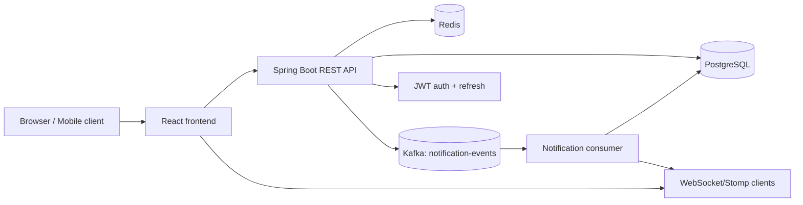
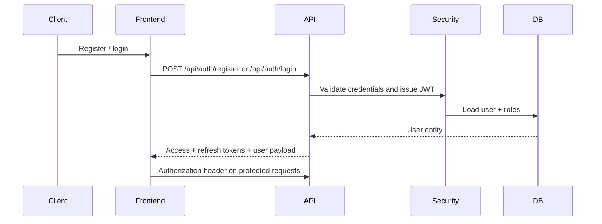
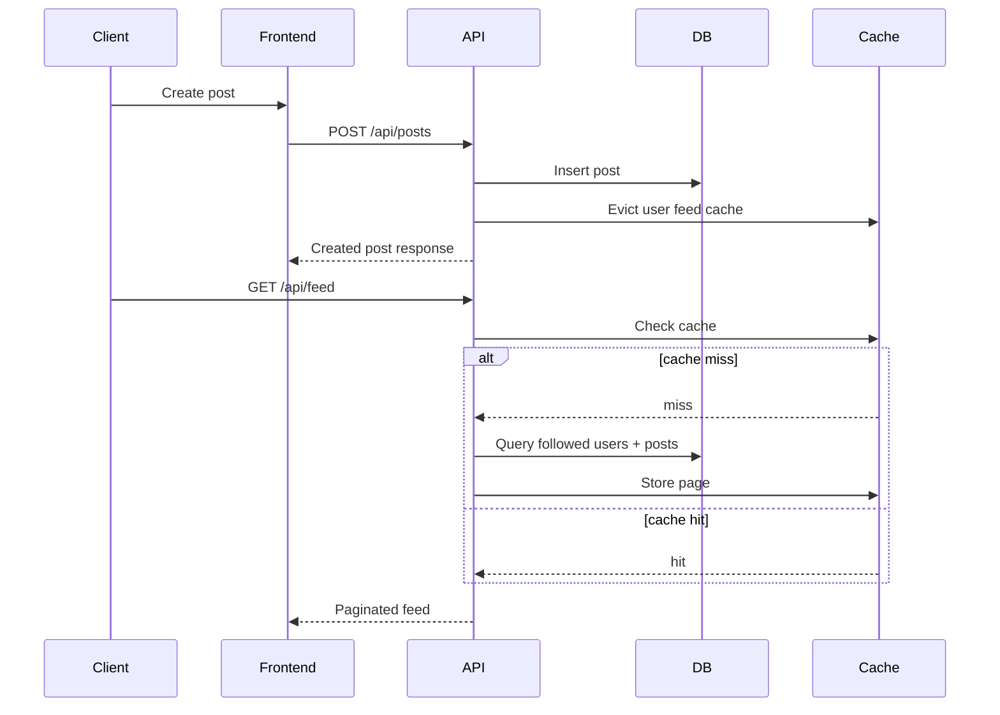

# Architecture

This repository contains a Java 17/Spring Boot backend and a React + TypeScript frontend for a social media platform with follow/feed logic, post interactions, notifications, and real-time WebSocket delivery.

## Runtime components

- Backend: Spring Boot 3.2, Spring Security, JPA, Kafka, Redis, Flyway, Actuator
- Frontend: React 18, Vite, Redux Toolkit, TanStack Query, MUI
- Data stores: PostgreSQL + Redis
- Eventing: Kafka topic `notification-events`
- Real-time delivery: STOMP/WebSocket via authenticated JWT connection
- Container orchestration: Docker Compose

## System diagram



## Request flows

### Authentication flow



### Post + feed flow



### Notification delivery flow

```mermaid
sequenceDiagram
    participant Actor as User action
    participant API
    participant Kafka
    participant Consumer
    participant DB
    participant WS
    participant Client

    Actor->>API: Like / follow / comment / share
    API->>Kafka: Emit NotificationEvent
    Kafka->>Consumer: Deliver event
    Consumer->>DB: Persist notification
    Consumer->>WS: Push live update
    WS-->>Client: WebSocket notification
```

## Key backend packages

- `backend/src/main/java/com/socialmedia/platform/controller` — HTTP controllers
- `backend/src/main/java/com/socialmedia/platform/service` — business logic
- `backend/src/main/java/com/socialmedia/platform/repository` — Spring Data repositories
- `backend/src/main/java/com/socialmedia/platform/security` — JWT, SecurityConfig, UserPrincipal
- `backend/src/main/java/com/socialmedia/platform/entity` — persistence model
- `backend/src/main/java/com/socialmedia/platform/event` — Kafka event payloads
- `backend/src/main/resources/db/migration` — Flyway migrations

## Key frontend packages

- `frontend/src/pages` — page-level screens
- `frontend/src/components` — reusable UI pieces
- `frontend/src/api` — Axios and WebSocket clients
- `frontend/src/redux` — auth + notification state
- `frontend/src/utils` — shared helpers and theme definitions

## Deployment topology

The repository ships with Docker Compose for local development and verification. The runtime stack is:

- PostgreSQL on port 5432
- Redis on port 6379
- Kafka on port 9092 (with ZooKeeper)
- Spring Boot backend on port 8080
- Frontend on port 3000

## Known limitations

- Google OAuth works only with real credentials in a provider-configured environment.
- Integration tests require a working Docker daemon.
- No production deployment target is wired to a managed cloud environment by default.
- The project intentionally avoids claiming cloud deployment when none is configured.
